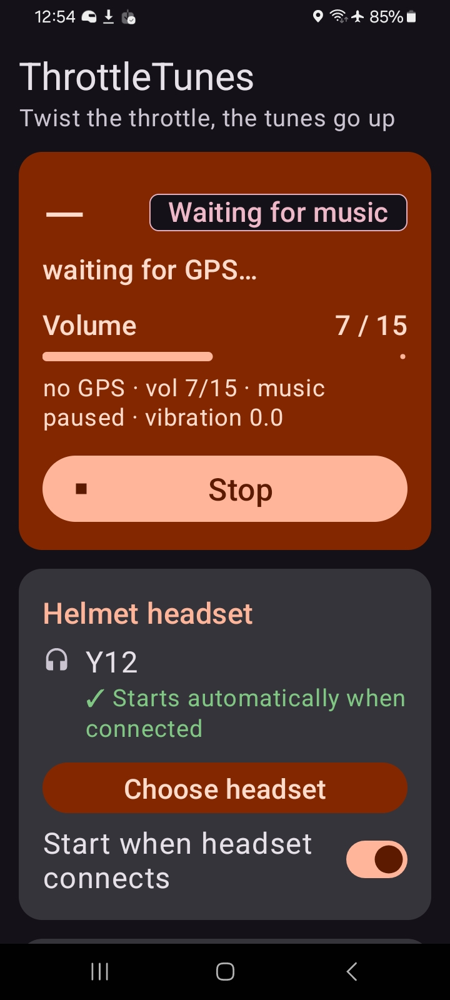
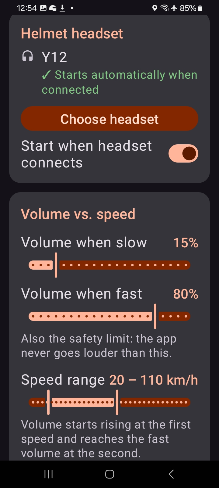
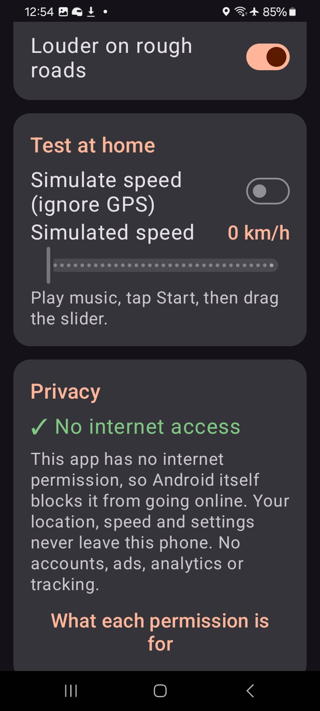

<p align="center">
  
</p>

<h1 align="center">ThrottleTunes</h1>

<p align="center">
  Speed-adaptive music volume for motorcycle helmet headsets.<br>
  Android 12+ · No internet permission · GPL-3.0
</p>

<p align="center">
  
  &nbsp;
  
  &nbsp;
  
</p>

---

ThrottleTunes raises your music volume as you ride faster and lowers it as you slow down, so the volume keeps up with wind noise.

## Features

- **GPS speed.** Read straight from the GPS chip. No Google Play Services, maps or network.
- **Smooth changes.** Filtered and stepped gradually, and small speed fluctuations are ignored.
- **Safety limit.** The configured maximum volume is never exceeded.
- **Respects manual changes.** If you use the headset's volume buttons, the app adopts that as your preference.
- **Tunnel and parking aware.** Uses the accelerometer to hold the volume when GPS drops out, and returns to the base volume when the bike is parked.
- **Automatic start.** Starts when your helmet headset connects and stops when it disconnects.
- **Battery friendly.** Only active while music is playing.
- **Ride history (optional).** Records routes on the device. Share the exact track as GPX/KML or open an approximate route in Google Maps.

## Privacy

ThrottleTunes does not request the `INTERNET` permission, so Android prevents it from making any network connection. Optional ride history is stored only on the device and leaves it only when you share a route. See [PRIVACY.md](PRIVACY.md) for details and verification steps.

## Download

Signed APKs are published on the [Releases](https://github.com/dil2743/ThrottleTune/releases/latest) page. An F-Droid listing is in progress.

Signing certificate SHA-256: `8b5949a4b91aed6677532a1d255e843d93be5a7a46d030916e72b58e99f16468`

## Setup

1. Pair your helmet headset in Android Bluetooth settings.
2. Open ThrottleTunes and grant the requested permissions. For location, choose **Allow all the time**.
3. Allow the app to run in the background.
4. Choose your headset and confirm the system pairing dialog to enable automatic start.
5. Adjust the volume and speed range. The defaults are 40% to 80% between 20 and 110 km/h.

Some manufacturers (Xiaomi, Oppo, Vivo, OnePlus, Samsung) may also require setting battery usage to *Unrestricted*.

## How it works

```
volume
 max ┤                 ┌───────
     │               ╱
base ┤──────────────╱
     └──────────────┬──┬────── speed
                  low  high
```

The target volume is interpolated linearly between the base and maximum volume across the configured speed range. It is low-pass filtered (τ ≈ 1.5 s) and applied one step at a time. Without GPS, the current volume is held while vibration indicates riding, and returns to base after 30 s of inactivity.

## Building

Requires JDK 17 and the Android SDK (API 35).

```bash
./gradlew testDebugUnitTest   # unit tests
./gradlew assembleRelease     # app/build/outputs/apk/release/
```

Release builds are unsigned unless the `RELEASE_KEYSTORE*` environment variables are set.

To release, update `versionName` and `versionCode` in `app/build.gradle.kts`, add `fastlane/metadata/android/en-US/changelogs/<versionCode>.txt`, then push a matching `vX.Y.Z` tag. GitHub Actions builds, signs and publishes the release. Signing requires the repository secrets `RELEASE_KEYSTORE_BASE64`, `RELEASE_KEYSTORE_PASSWORD`, `RELEASE_KEY_ALIAS` and `RELEASE_KEY_PASSWORD`.

## Project structure

| File | Purpose |
|---|---|
| `VolumeController.kt` | Volume decision logic (unit tested) |
| `VibrationSource.kt` | Orientation-independent vibration level (unit tested) |
| `SpeedSource.kt` | GPS speed |
| `VolumeService.kt` | Foreground service and notification |
| `HeadsetReceiver.kt` | Automatic start and stop on headset connection |
| `MainActivity.kt` | Settings and live status |
| `Track.kt` | Ride track summary and GPX/KML/Maps export (unit tested) |
| `RideStore.kt`, `RidesActivity.kt` | On-device ride storage and the Rides screen |
| `RideTileService.kt` | Quick Settings tile |
| `Prefs.kt` | Persisted settings |

## License

[GNU General Public License v3.0](LICENSE)
